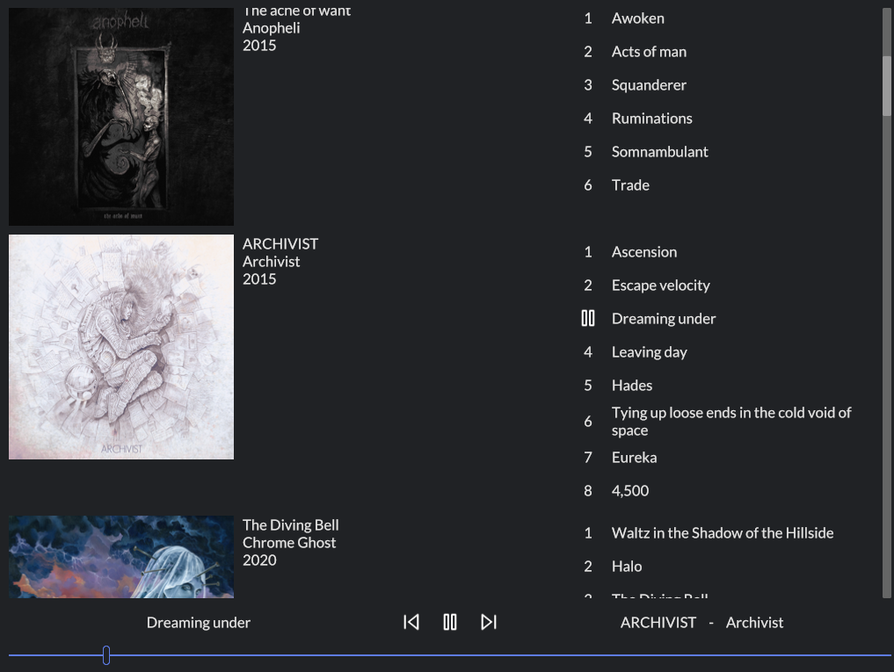

Clef is a native local music player, similar to classic iTunes or MediaMonkey. It's built on top of [libcosmic](https://github.com/pop-os/libcosmic) and [Symphonia](https://github.com/pdeljanov/Symphonia).

## Install

Download a `.deb` from the [Releases](https://github.com/Giesch/clef/releases) page.
